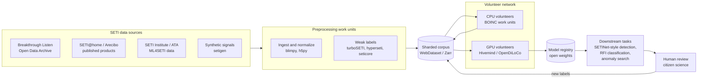

# EI@Home — Extraterrestrial Intelligence at Home

**Using SETI signals to train AI models.**

EI@Home is an open-source, volunteer-powered distributed infrastructure that turns
the world's SETI radio data into **training data** for AI. For two decades the
question has been *"How can AI help us find signals in SETI data?"* EI@Home also
asks the reverse: *"What can AI learn **from** SETI data?"*

We combine three things:

1. **SETI data**: decades of radio observations from SETI@home (Arecibo), Breakthrough Listen
   (Green Bank, Parkes, MeerKAT), and the SETI Institute (Allen Telescope Array).
2. **SETI-focused neural networks**, starting from
   [SETINet](https://github.com/Agora-Lab-AI/SETINet) and published deep-learning
   technosignature searches.
3. **A volunteer computing network** in the spirit of
   [SETI@home](https://setiathome.berkeley.edu/), built on
   [BOINC](https://boinc.berkeley.edu/) and modern decentralized training frameworks.

> **Status: early planning.** This README describes our goals and the tools we plan
> to use. Nothing is running yet. Issues, ideas and pull requests are welcome.

---

## Table of contents

- [Why EI@Home?](#why-eihome)
- [Goals](#goals)
- [How it will work](#how-it-will-work)
- [Roadmap](#roadmap)
- [Open-source projects we can build on](#open-source-projects-we-can-build-on)
- [Data sources](#data-sources)
- [Resources for volunteers](#resources-for-volunteers)
- [FAQ](#faq)
- [Contributing](#contributing)
- [License](#license)
- [Acknowledgments](#acknowledgments)

---

## Why EI@Home?

- **SETI@home showed what volunteers can do.** From 1999 until it went into hibernation in
  March 2020, millions of volunteers donated idle computer time to analyze Arecibo data. In 2025
  the team published its final analysis
  ([*SETI@home: Data Analysis and Findings*](https://arxiv.org/abs/2506.14737)), and its
  top-ranked candidates were selected for reobservation with China's FAST telescope.
- **SETI already produces huge amounts of radio data.** Breakthrough Listen alone has
  released petabyte-scale observations through its
  [Open Data Archive](https://seti.berkeley.edu/opendata).
- **Almost all of that data is noise, radio-frequency interference (RFI) and natural
  astrophysical emission.** That makes it a poor place to find a confirmed alien signal, but a
  good place to learn what the radio sky and Earth's own radio emissions look like. A model
  can't recognize an anomaly until it knows what "normal" looks like.
- **Most SETI machine learning trains small models on curated subsets** and uses them only as
  filters. To our knowledge there is no large, open, self-supervised **foundation model for
  radio time-frequency data** trained at SETI scale, and no volunteer network dedicated to
  building one.

EI@Home aims to fill that gap and give back to SETI: better models of RFI and noise make every
future technosignature search more sensitive.

## Goals

### Primary goals

1. **Open SETI training corpus.** Collect SETI observations, convert them into normalized,
   machine-learning-ready shards (spectrogram tiles, observation cadences, voltage snippets),
   and keep full provenance: telescope, receiver, frequency band, target, timestamp and
   known-RFI annotations.
2. **A radio foundation model.** Pretrain self-supervised models (masked spectrogram modeling,
   contrastive learning, variational autoencoders) on that corpus to produce a general-purpose
   encoder for radio time-frequency data.
3. **Distributed volunteer training.** Let volunteers contribute CPU and GPU time for data
   preprocessing, synthetic signal injection, weak labeling, evaluation and low-communication
   distributed training.
4. **Close the loop with SETI.** Fine-tune the foundation model for downstream tasks such as
   technosignature detection (SETINet-style classifiers), RFI classification and anomaly
   search. Then run those models back over the archives and send interesting candidates to
   humans for review.
5. **Open science.** Publish code, data derivatives, model weights and results under open
   licenses, make the work reproducible, and credit every volunteer.

### Guiding principles

- **Volunteer first:** easy to install, safe to run, respectful of volunteers' machines, power
  and bandwidth.
- **Open by default:** open data, open weights, open code and an open roadmap.
- **Honest science:** no hype. We report negative results, and a "candidate" is not a detection.
- **Give back:** tools, datasets and models should be useful to the wider SETI and radio
  astronomy communities.

### Non-goals (for now)

- Claiming or confirming detections of extraterrestrial intelligence.
- Replacing SETI@home, Breakthrough Listen or the SETI Institute's own pipelines. We build on
  and alongside them.
- Training general-purpose language models.

## How it will work

### Planned work-unit types

| Work unit | Hardware | What it does | Built on |
|---|---|---|---|
| **Ingest** | CPU, bandwidth | Download archive files, convert filterbank and HDF5 data into normalized tiles, write shards | blimpy, h5py, hdf5plugin, WebDataset |
| **Synthesize** | CPU | Inject synthetic narrowband, drifting and pulsed signals into real backgrounds to create labeled examples | setigen |
| **Weak-label** | CPU / GPU | Run classical de-Doppler searches to produce "hit" labels and RFI flags | turboSETI, hyperseti, seticore |
| **Train** | GPU | Run local optimizer steps on a shard, then synchronize infrequently with peers | PyTorch, Hivemind, OpenDiLoCo |
| **Evaluate / search** | CPU / GPU | Run released models over archive data and report anomaly scores | ONNX Runtime |

### Hard problems we expect to work on

- **Trust and validation:** checking results from untrusted volunteer machines through BOINC
  replication and quorum, deterministic seeds, and sanity checks on gradients and weight deltas.
- **Bandwidth:** SETI files are often several gigabytes each. We need to move features and
  compressed shards rather than raw data, and keep data close to the volunteers who use it.
- **Heterogeneous hardware:** many GPU vendors and memory sizes, plus volunteers who join and
  leave at any time.
- **Evaluation:** there are no confirmed extraterrestrial signals to test against, so we need
  injection-recovery tests, held-out RFI benchmarks and comparison with published searches.

## Roadmap

**Phase 0: Foundations** *(current)*
- [x] Repository, license and project goals
- [ ] `CONTRIBUTING.md`, code of conduct and issue templates
- [ ] Survey of data sources, formats, sizes and licenses
- [ ] Architecture decision records: data format, training framework, volunteer platform

**Phase 1: Data**
- [ ] Ingest pipeline for the Breakthrough Listen open data (filterbank / HDF5 to tiles)
- [ ] Synthetic injection pipeline with setigen
- [ ] Weak labels from turboSETI, hyperseti or seticore
- [ ] `eiathome-corpus-v0` published with a datasheet

**Phase 2: Baseline models (single machine)**
- [ ] Reproduce a SETINet baseline on the v0 corpus
- [ ] Reproduce the β-VAE approach from Ma et al. (2023)
- [ ] First self-supervised pretraining run and benchmark suite

**Phase 3: Volunteer pilot**
- [ ] BOINC pilot (for example via [BOINC Central](https://boinc.berkeley.edu/central/scientist.php)) for ingest, synthesis and evaluation work units
- [ ] Hivemind / OpenDiLoCo training pilot with a small group of trusted GPU volunteers
- [ ] Volunteer credit, leaderboard and public dashboard

**Phase 4: Scale and give back**
- [ ] Public volunteer launch
- [ ] Foundation model v1 with open weights and a model card
- [ ] Archive-wide anomaly search, with candidates shared for human review and with SETI researchers

## Open-source projects we can build on

Licenses vary. Before copying code into this MIT-licensed repository, check the project's
license. GPL code, for example, should be used as a separate dependency or process.

### SETI signal processing and data I/O

| Project | What it gives us |
|---|---|
| [blimpy](https://github.com/UCBerkeleySETI/blimpy) | Python I/O for Breakthrough Listen filterbank (`.fil`) and HDF5 (`.h5`) data, plus plotting |
| [turboSETI](https://github.com/UCBerkeleySETI/turbo_seti) | Narrowband drifting-signal (de-Doppler) search; the classic Breakthrough Listen hit finder |
| [hyperseti](https://github.com/UCBerkeleySETI/hyperseti) | GPU-accelerated narrowband technosignature search |
| [seticore](https://github.com/lacker/seticore) | High-performance C++/CUDA de-Doppler search and beamforming for Breakthrough Listen data |
| [rawspec](https://github.com/UCBerkeleySETI/rawspec) | GPU tool for turning GUPPI raw voltage data into filterbank spectra |
| [setigen](https://github.com/bbrzycki/setigen) | Synthetic signal generation and injection for spectrograms and raw voltages; our main source of labeled data |
| [your](https://github.com/thepetabyteproject/your) | Unified reader for radio-astronomy formats, with candidate tools for transients |
| [sigpyproc3](https://github.com/FRBs/sigpyproc3) | Filterbank processing for pulsar and fast-transient work |
| [astropy](https://github.com/astropy/astropy), [h5py](https://github.com/h5py/h5py), [hdf5plugin](https://github.com/silx-kit/hdf5plugin) | Coordinates, units and time; HDF5 access, including the bitshuffle compression used in Breakthrough Listen files |

### SETI machine learning (models and prior work)

| Project | What it gives us |
|---|---|
| [SETINet](https://github.com/Agora-Lab-AI/SETINet) | MIT-licensed PyTorch CNN framework for technosignature detection in spectral data. An early-stage starting point for our detection head and training loop |
| [ML_GBT_SETI](https://github.com/PetchMa/ML_GBT_SETI) | Code for Ma et al. 2023, [*A deep-learning search for technosignatures from 820 nearby stars*](https://arxiv.org/abs/2301.12670) (β-VAE on Green Bank data) |
| [ML4SETI](https://github.com/setiQuest/ML4SETI) | SETI Institute / IBM 2017 signal-classification challenge using simulated Allen Telescope Array spectrograms |
| [Kaggle: SETI Breakthrough Listen, E.T. Signal Search](https://www.kaggle.com/c/seti-breakthrough-listen) | 2021 competition with labeled injected "needles" in real observation cadences, plus many public solutions |

### Volunteer computing

| Project | What it gives us |
|---|---|
| [BOINC](https://github.com/BOINC/boinc) ([site](https://boinc.berkeley.edu/)) | The platform behind SETI@home: work-unit scheduling, result validation, volunteer credit and CPU/GPU clients. BOINC is adding Docker-based applications, which would make it much easier to ship PyTorch work units |
| [BOINC Central](https://boinc.berkeley.edu/central/scientist.php) | Hosted BOINC infrastructure for scientists, so a pilot doesn't need its own server |
| [SETI@home source](https://setiathome.berkeley.edu/sah_porting.php) | Reference implementation of the original client and its signal processing (GPL) |
| [MLC@Home](https://www.mlcathome.org/) | Precedent: the first BOINC project dedicated to machine learning (UMBC). It trained more than 750,000 neural networks on volunteer machines ([MLDS paper](https://arxiv.org/abs/2104.10555)) |

### Decentralized and distributed training

| Project | What it gives us |
|---|---|
| [Hivemind](https://github.com/learning-at-home/hivemind) | PyTorch library for decentralized training over the internet, with a DHT, fault tolerance and peers that join and leave |
| [OpenDiLoCo](https://github.com/PrimeIntellect-ai/OpenDiLoCo) | Open implementation of DiLoCo low-communication training on top of Hivemind ([paper](https://arxiv.org/abs/2407.07852)) |
| [Psyche](https://github.com/PsycheFoundation/psyche) | Systems for distributed training of transformers over the internet among untrusted parties (Apache-2.0) |
| [Petals](https://github.com/bigscience-workshop/petals) | Collaborative inference and fine-tuning of large models across volunteer GPUs |
| [Flower](https://github.com/flwrlabs/flower) | Federated learning framework, useful if data must stay at telescope sites |
| [Ray](https://github.com/ray-project/ray) | Distributed compute for the trusted core cluster: preprocessing, hyperparameter sweeps and evaluation |

### Machine learning stack

| Project | What it gives us |
|---|---|
| [PyTorch](https://github.com/pytorch/pytorch) | Main training framework (also used by SETINet and Hivemind) |
| [ONNX Runtime](https://github.com/microsoft/onnxruntime) | Portable, lightweight inference on volunteer hardware |
| [Hugging Face Datasets](https://github.com/huggingface/datasets) | Dataset distribution, streaming and dataset cards; the Hub can host open weights |
| [WebDataset](https://github.com/webdataset/webdataset) / [Zarr](https://github.com/zarr-developers/zarr-python) | Sharded, streamable storage for large spectrogram corpora |
| [Lightly](https://github.com/lightly-ai/lightly) | Self-supervised learning building blocks |
| [MLflow](https://github.com/mlflow/mlflow) / [DVC](https://github.com/treeverse/dvc) | Experiment tracking, plus data and model versioning |

### Citizen science and volunteer radio (longer term)

| Project | What it gives us |
|---|---|
| [Zooniverse Project Builder](https://www.zooniverse.org/lab) | Free platform for human labeling and review of model candidates |
| [GNU Radio](https://github.com/gnuradio/gnuradio) / [RTL-SDR](https://osmocom.org/projects/rtl-sdr/wiki) | Software-defined radio tools for volunteers who want to capture their own radio data or RFI surveys |
| [SatNOGS](https://satnogs.org/) | A working model of a global, volunteer-run network of radio ground stations with open data |

## Data sources

| Source | Instrument(s) | Notes |
|---|---|---|
| [Breakthrough Listen Open Data Archive](https://seti.berkeley.edu/opendata) ([search](https://breakthroughinitiatives.org/opendatasearch)) | Green Bank Telescope, Parkes and others | Filterbank, HDF5 and raw voltage products. Individual files are often several GB |
| [Breakthrough Listen Data Release 1](https://seti.berkeley.edu/listen2019/opendata.html) | GBT, Parkes | 1,327-star survey ([paper](https://arxiv.org/abs/1906.07750)). A well-documented first target |
| [Kaggle SETI Breakthrough Listen](https://www.kaggle.com/c/seti-breakthrough-listen) | GBT | Preprocessed cadence snippets with labeled synthetic needles |
| [ML4SETI](https://github.com/setiQuest/ML4SETI) | Allen Telescope Array (simulated) | Labeled signal classes for supervised fine-tuning |
| [SETI@home](https://setiathome.berkeley.edu/) | Arecibo | Published methods and candidate analysis ([paper](https://arxiv.org/abs/2506.14737)). We will contact the Berkeley team about access to derived data products |
| Synthetic ([setigen](https://github.com/bbrzycki/setigen)) | Any | Unlimited labeled signals injected into real backgrounds |

Every dataset we publish will include a datasheet covering its source, license, preprocessing,
known biases and RFI environment.

## Resources for volunteers

### Ways to help

| You have... | You can... |
|---|---|
| **A computer** | Donate CPU and GPU time once our BOINC pilot launches. Until then, install the [BOINC client](https://boinc.berkeley.edu/download.php) and get familiar with it on an existing project |
| **A GPU** | Join the decentralized training pilot (Phase 3). Watch this repository for announcements |
| **Python / ML skills** | Help build ingest pipelines, baselines, self-supervised pretraining and evaluation |
| **Systems / DevOps skills** | Help with BOINC server setup, Docker work units, storage, CI and dashboards |
| **Radio astronomy or SETI knowledge** | Review data choices, RFI handling and evaluation methods, and keep the science honest |
| **Time and curiosity** | Test documentation, review candidates on our future citizen-science project and spread the word |

### Learn the background

**SETI and radio data**
- [Breakthrough Listen data overview](https://seti.berkeley.edu/listen/data.html) and the [Open Data Archive](https://seti.berkeley.edu/opendata)
- [blimpy documentation](https://blimpy.readthedocs.io/): reading and plotting SETI data files
- [setigen documentation](https://setigen.readthedocs.io/): generating synthetic signals
- [Hack4Dev SETI Project](https://github.com/Hack4Dev/SETI_Project): hands-on notebooks that walk through the turboSETI pipeline with real data (archived but still useful)
- [*SETI@home: Data Analysis and Findings*](https://arxiv.org/abs/2506.14737) (2025): how SETI@home turned volunteer results into candidates
- [Analysis of the Breakthrough Listen signal of interest blc1](https://arxiv.org/abs/2111.06350): how a candidate was checked and found to be interference

**Machine learning for SETI**
- [Ma et al. 2023, *A deep-learning search for technosignatures from 820 nearby stars*](https://arxiv.org/abs/2301.12670) (Nature Astronomy)
- [Classification of simulated radio signals using Wide Residual Networks for SETI](https://arxiv.org/abs/1803.08624)
- [*A Novel Technosignature Search in the Breakthrough Listen Green Bank Telescope Archive*](https://arxiv.org/abs/2412.05786)
- [SETINet](https://github.com/Agora-Lab-AI/SETINet)

**Volunteer and distributed computing**
- [BOINC](https://boinc.berkeley.edu/): volunteer computing platform and client downloads
- [BOINC Central for scientists](https://boinc.berkeley.edu/central/scientist.php)
- [DiLoCo: Distributed Low-Communication Training](https://arxiv.org/abs/2311.08105) and [OpenDiLoCo](https://arxiv.org/abs/2407.07852)
- [Hivemind](https://github.com/learning-at-home/hivemind)
- [MLC@Home MLDS paper](https://arxiv.org/abs/2104.10555): lessons from training neural networks on BOINC

### Safety for volunteers

We plan to:
- Run work units sandboxed (BOINC wrappers, containers) with no access to personal files.
- Let volunteers control CPU/GPU limits, schedules and bandwidth through the BOINC client.
- Keep all code open source, and make released binaries reproducible and signed.
- Collect no personal data beyond what BOINC needs for credit.

## FAQ

**Will EI@Home find aliens?**
Probably not directly, and we won't claim it has. Our aim is better AI models of the radio sky,
which make every SETI search, including future reobservations, more sensitive.

**Why train on SETI data if it's mostly noise and interference?**
Because that's what makes it useful. It is a huge, real-world, well-documented radio dataset.
Models that understand interference and noise can filter it better and flag what doesn't fit.

**Is this affiliated with SETI@home, Berkeley SETI Research Center, Breakthrough Listen or the SETI Institute?**
No. EI@Home is an independent open-source project that builds on their public tools and data.
We hope to collaborate with them.

**How is this different from SETINet?**
SETINet is a model framework for finding technosignatures. EI@Home is the data, volunteer and
training infrastructure around models like it. We plan to use SETINet as a baseline and
downstream task.

## Contributing

We're just getting started, so the best ways to contribute right now are:

1. **Open an issue** with ideas, data sources, related projects or questions.
2. **Pick a roadmap item** from Phase 0 or Phase 1 and say in an issue that you're working on it.
3. **Share expertise** in SETI, radio astronomy, distributed systems or self-supervised learning.

A `CONTRIBUTING.md` and code of conduct are coming soon.

## License

EI@Home is released under the [MIT License](LICENSE). Third-party projects and datasets listed
above keep their own licenses and terms of use.

## Acknowledgments

EI@Home stands on the shoulders of the SETI@home volunteers and the UC Berkeley SETI Research
Center, Breakthrough Listen, the SETI Institute, the BOINC community, and the authors of every
open-source project listed above.
