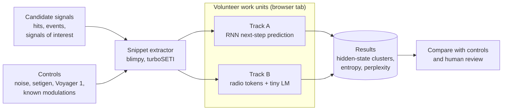

# EI@Home — Extraterrestrial Intelligence at Home

**What does an AI learn when candidate alien signals are its training data?**

Most machine learning in SETI trains a *filter*: a model whose job is to recognize
terrestrial interference and throw it away. EI@Home flips that pipeline. We take the
**candidate signals** themselves (the narrowband hits and signals of interest that make it
through SETI search pipelines), use them as **training data**, and then study what the
models learned.

It's meant to be a fun, hackable open-source project:

- **Small models first.** Compact recurrent networks and tiny language models that train on
  a laptop or a consumer GPU.
- **Two experiment tracks.** One treats signals as continuous dynamics, the other treats them
  as a possible language.
- **Strong controls.** Every result is compared against noise, synthetic signals, known human
  transmissions and shuffled versions of the data.
- **Volunteer computing in a browser tab.** Many small, independent runs on volunteers'
  own CPUs and GPUs, in the spirit of [SETI@home](https://setiathome.berkeley.edu/), with
  nothing to install. [BOINC](https://boinc.berkeley.edu/) stays an option for heavier jobs
  later.

> **Status: early planning.** This README describes the goals, experiment design and the
> tools we plan to use. Nothing is running yet. Issues, ideas and pull requests are welcome.
> The full experiment protocol is in [`docs/experiments.md`](docs/experiments.md).

## Quick start

**In your browser (no install):** open the **[EI@Home Live Lab](https://davidmdrpi.github.io/EIatHome/)**.
Pick a signal, press Train, and watch a small GRU learn to predict it, live, on your own CPU or
GPU. The same page runs **work units**: small, reproducible experiments that produce a result
card you can download or submit. Nothing leaves your browser unless you choose to send it.

**In Python:** the [**Hello, Voyager**](tracks/rnn/hello_voyager.ipynb) notebook runs the same
Track A experiment on the full Breakthrough Listen observation of Voyager 1.

```bash
git clone https://github.com/davidmdrpi/EIatHome.git
cd EIatHome
pip install -r requirements.txt
jupyter lab tracks/rnn/hello_voyager.ipynb
```

To work on the Live Lab itself, see [`web/README.md`](web/README.md).

---

## Table of contents

- [Quick start](#quick-start)
- [Why EI@Home?](#why-eihome)
- [Goals](#goals)
- [The experiments](#the-experiments)
- [Why small recurrent models?](#why-small-recurrent-models)
- [How volunteers fit in](#how-volunteers-fit-in)
- [Roadmap](#roadmap)
- [Open-source projects we can build on](#open-source-projects-we-can-build-on)
- [Data sources](#data-sources)
- [Resources for volunteers](#resources-for-volunteers)
- [FAQ](#faq)
- [Contributing](#contributing)
- [License](#license)
- [Acknowledgments](#acknowledgments)

---

## Why EI@Home?

- **SETI@home showed what volunteers can do.** From 1999 until it went into hibernation in
  March 2020, millions of volunteers donated idle computer time to analyze Arecibo data. In 2025
  the team published its final analysis
  ([*SETI@home: Data Analysis and Findings*](https://arxiv.org/abs/2506.14737)), and its
  top-ranked candidates were selected for reobservation with China's FAST telescope.
- **SETI produces a lot of candidates.** Breakthrough Listen has released petabyte-scale
  observations through its [Open Data Archive](https://seti.berkeley.edu/opendata), and its
  search tools flag large numbers of narrowband "hits" in them.
- **Machine learning in SETI is mostly built to discard.** Models are trained to reject
  interference so that humans see fewer candidates. Much less work asks the reverse question:
  if you train a model *on* the candidates, what structure does it find?
- **Candidate signals are short, structured time series.** A candidate is typically a small
  time-frequency snippet (a waterfall spectrogram) or a stretch of raw baseband samples. Its
  information lives in temporal dynamics: Doppler drift, modulation and pulsing. That's a good
  fit for small sequence models, and small models are a good fit for volunteer computing.

## Goals

1. **Flip the pipeline.** Treat candidate SETI signals as training data, and make "what did the
   model learn?" the main research question.
2. **Run two complementary experiment tracks.**
   - **Track A (continuous):** recurrent models that predict the next time step of a signal.
   - **Track B (discrete):** turn signals into "radio tokens", look for linguistic
     fingerprints, and train tiny language models on the token streams.
3. **Keep the science honest.** Every result is reported against noise, synthetic signals,
   known human transmissions and surrogate (shuffled) data. Negative results count.
4. **Make it hackable.** Experiments should run on a laptop, come with notebooks, and be easy
   to extend with a new model, tokenizer or metric.
5. **Use volunteer computing.** Package experiments as small, independent work units so
   volunteers can run large sweeps across seeds, models and candidate sets.
6. **Open science.** Publish code, snippet datasets, model weights and results under open
   licenses, and credit every volunteer.

### Guiding principles

- **Small and hackable first:** a new contributor should be able to run an experiment in an
  afternoon.
- **Volunteer first:** easy to install, safe to run, and respectful of volunteers' machines,
  power and bandwidth.
- **Honest science:** no hype. A "candidate" is not a detection, and a "language-like"
  statistic is not a message.
- **Give back:** tools and datasets should be useful to the wider SETI and radio astronomy
  communities.

### Non-goals (for now)

- Claiming or confirming detections of extraterrestrial intelligence.
- Replacing the search pipelines of SETI@home, Breakthrough Listen or the SETI Institute. We
  build on their outputs.
- Building a large foundation model or a general-purpose language model on day one. That's a
  possible stretch goal, not the starting point.

## The experiments

The full protocol, including data specifications, metrics and known pitfalls, is in
[`docs/experiments.md`](docs/experiments.md). Here is the summary.

### What counts as a "candidate signal"

| Tier | What it is | Scale | How we use it |
|---|---|---|---|
| **Hits** | Any narrowband detection above threshold from turboSETI, hyperseti or seticore | Very large | Bulk training data |
| **Events** | Hits that appear in on-source scans but not in the off-source scans of the same observing cadence | Much smaller | Main training and analysis set |
| **Signals of interest** | Named candidates that got close scrutiny, such as [blc1](https://seti.berkeley.edu/blc1/), the eight signals from [Ma et al. 2023](https://arxiv.org/abs/2301.12670) and SETI@home's reobservation candidates | A handful to about 100 | Held-out case studies, never used for tuning |

Every candidate examined in detail so far has turned out to be, or is most likely, human-made
interference. So the first thing our models will learn is the "language" of human radio. That's
why known human transmissions are a built-in **positive control** for both tracks.

### Track A: Continuous sequence modeling (the RNN track)

Feed short slices of a signal into an autoregressive recurrent model whose task is to
**predict the next time step**.

- **Inputs:** sequences of spectrogram frames around a hit, or complex I/Q baseband samples
  from raw voltage data.
- **Models:** GRU, LSTM, minGRU/minLSTM, Mamba-style state-space models and RWKV, plus a
  tiny transformer as a baseline.
- **What we measure:**
  - Prediction error compared with the controls.
  - Hidden-state trajectories, projected with PCA or UMAP and then clustered.
  - Linear probes for drift rate, pulse period and modulation type, tested on controls where
    the answer is known.
- **The question:** if a signal has structured modulation rather than thermal noise or a
  simple radar-like sweep, the hidden states should organize around its dynamical rules. Do
  candidates cluster with noise, with simple synthetic tones, with known human modulations, or
  on their own?

**A physical constraint:** Breakthrough Listen's standard narrowband data product averages
about 18 seconds per time step, so a 5-minute scan has only about 16 steps. It also stores
power only, so phase information is gone. Track A therefore uses mid-resolution products (about
1 second per step) for drift and pulsing, and raw voltages or synthetic I/Q for phase and
modulation.

### Track B: Discrete "signal-to-language" tokenization (the LLM track)

Even without knowing how an extraterrestrial signal might be encoded, we can test whether it
behaves like a language.

1. **Tokenize.** Train a lightweight quantizer (a VQ-VAE, FSQ or a neural audio codec adapted
   to two-channel I/Q) to compress short slices of signal into a discrete vocabulary of
   "radio tokens". We sweep vocabulary sizes.
2. **Look for linguistic fingerprints:**
   - Zipf-like rank-frequency distributions.
   - Drops in higher-order (conditional) entropy, which indicate rules and redundancy.
   - Power-law decay of mutual information between distant tokens, a signature of
     hierarchical structure ([Lin & Tegmark](https://arxiv.org/abs/1606.06737)).
   - Compressibility and repeating motifs.
3. **See if it "speaks back."** Train a small causal language model (or an RNN) on the token
   stream. Measure its perplexity against shuffled and Markov-surrogate streams, then sample
   from it and check whether the generated streams reproduce the real statistics.

**A warning built into the design:** Zipf-like distributions also appear in
[random text](https://doi.org/10.1109/18.165464), and tokenizers can impose structure of their
own. Every Track B metric is reported against null models, including the same tokenizer
applied to pure noise.

### Controls: how we keep ourselves honest

| Control | Why it's there |
|---|---|
| Thermal noise and off-source scans | Should show no structure; calibrates every metric |
| Synthetic signals from setigen (tones, drifts, pulses) | Known simple structure. Checks that models recover drift rate and pulse period |
| Voyager 1 observation (turboSETI's example file) | A real human-made transmitter in interstellar space: a carrier with telemetry sidebands |
| Known digital modulations (TorchSig, GNU Radio) | Signals that really carry information; the positive control for "language-like" |
| Surrogates: shuffled, time-reversed, Markov-k | Remove specific kinds of structure to show what each metric actually measures |

**What would count as interesting:** a group of candidates whose structure beats every null
surrogate, doesn't match noise, simple synthetic signals or known human modulations, and holds
up across seeds, tokenizers and model types. Even then, the first suspect is human interference.
A result like that is a reason to involve SETI researchers, not an announcement.

## Why small recurrent models?

- **They match the physics.** Candidate signals are short sequences whose information is in how
  they change over time. Recurrent models step through time and carry a state, which is exactly
  what drift, modulation and pulsing need.
- **They're cheap.** Small parameter counts and constant memory per step make them practical on
  consumer GPUs, laptops and BOINC CPU work units, and cheap enough to run thousands of
  independent experiments.
- **Their state is easy to inspect.** A hidden state is a compact vector you can plot, cluster
  and probe.
- **We test the claim instead of assuming it.** For windows this short, a tiny transformer is
  also cheap. That's why every Track A experiment includes one as a baseline. minGRU/minLSTM
  train in parallel without backpropagation through time. The official Mamba kernels need an
  NVIDIA GPU, but pure-PyTorch versions run anywhere.

## How volunteers fit in



Each work unit is one small, independent experiment: one snippet set, one model configuration
and one random seed. Volunteers don't need to synchronize, so this works like
[MLC@Home](https://www.mlcathome.org/), which trained more than 750,000 small neural networks on
BOINC.

**Browser first.** The [Live Lab](https://davidmdrpi.github.io/EIatHome/) is a static site
(GitHub Pages) that runs work units in a Web Worker with TensorFlow.js, on WebAssembly, WebGPU
or WebGL. Each unit is fully determined by its number, so anyone can re-run it: replication is
how results are checked. Signals come either from in-browser generators or from **micro-slices**,
16 KB windows of real data cut by [`tools/extract_slices.py`](tools/extract_slices.py), so
nobody downloads a multi-gigabyte file. Results are small JSON cards that volunteers download or
submit as a pre-filled GitHub issue. There's no server to run or pay for.

The first browser work unit, `track-a/v0`, replicates the Hello, Voyager notebook. The table
below is the full plan. Heavier units (raw voltages, long sweeps) may later move to BOINC,
whose replication and quorum checks validate results automatically.

| Work unit | Hardware | What it does |
|---|---|---|
| **Extract** | CPU, bandwidth | Download archive files and cut fixed-size snippets around hits, with matched controls |
| **Synthesize** | CPU | Generate control snippets with setigen and TorchSig |
| **Train A** | CPU or small GPU | Train one small recurrent model; return metrics, hidden-state summaries and weights |
| **Tokenize B** | CPU or small GPU | Train a tokenizer, convert snippets to token streams, and compute linguistic metrics against surrogates |
| **Language model B** | CPU or small GPU | Train a tiny causal language model on token streams and report perplexity against surrogates |

Synchronous distributed training of larger shared models (for example with Hivemind or
OpenDiLoCo) is a stretch goal for later.

### Repository layout

```text
EIatHome/
├── web/         # the Live Lab: a static site, deployed to GitHub Pages
│   ├── js/      # signal generators, Track A engine, Track B metrics, UI
│   ├── data/    # micro-slices of real observations
│   └── vendor/  # TensorFlow.js, pinned and vendored
├── tools/       # extract_slices.py and other data tools
├── tracks/
│   ├── rnn/     # Track A notebooks (hello_voyager.ipynb)
│   └── tokens/  # Track B notebooks (planned)
├── docs/        # experiment protocol and design notes
└── data/        # downloaded observations (git-ignored)
```

## Roadmap

**Phase 0: Foundations** *(current)*
- [x] Repository, license, project goals and experiment design
- [ ] `CONTRIBUTING.md`, code of conduct and issue templates
- [ ] Choose the first observations and candidate sets

**Phase 1: Snippets and controls**
- [ ] Snippet extractor around turboSETI hits (raw and de-drifted versions, with metadata)
- [ ] Control sets: noise, off-source scans, setigen, Voyager 1, TorchSig modulations
- [ ] Surrogate generators: shuffled, time-reversed, Markov-k
- [ ] Starter notebook [Hello, Voyager](tracks/rnn/hello_voyager.ipynb) confirmed end to end on the real observation

**Phase 2: Track A (RNN)**
- [ ] GRU, LSTM and minGRU next-step baselines, plus a tiny transformer baseline
- [ ] Hidden-state projection, clustering and linear probes
- [ ] First report: candidates compared with every control

**Phase 3: Track B (tokens)**
- [ ] VQ-VAE and FSQ tokenizers with a vocabulary-size sweep
- [ ] Linguistic metrics with null models (Zipf, entropy, mutual information, compressibility)
- [ ] Tiny causal language model on token streams; perplexity against surrogates

**Phase 4: Volunteers**
- [x] Browser Live Lab with Track A training, Track B token metrics and `track-a/v0` work units
- [ ] Enable GitHub Pages and publish the real Voyager micro-slices
- [ ] Collect submitted result cards and compare replications
- [ ] Public volunteer pilot and results dashboard
- [ ] Heavier work units on BOINC, if needed (for example via [BOINC Central](https://boinc.berkeley.edu/central/scientist.php))

**Stretch goals**
- [ ] Raw-voltage track at scale
- [ ] Larger shared models trained with decentralized training frameworks
- [ ] Citizen-science review of unusual clusters

## Open-source projects we can build on

Licenses vary. Before copying code into this MIT-licensed repository, check the project's
license. GPL or non-commercial code, for example, should stay a separate dependency.

### SETI signal processing and data I/O

| Project | What it gives us |
|---|---|
| [blimpy](https://github.com/UCBerkeleySETI/blimpy) | Python I/O for Breakthrough Listen filterbank (`.fil`) and HDF5 (`.h5`) data, plus plotting |
| [turboSETI](https://github.com/UCBerkeleySETI/turbo_seti) | Narrowband drifting-signal (de-Doppler) search: produces the hits and events we train on |
| [hyperseti](https://github.com/UCBerkeleySETI/hyperseti) | GPU-accelerated narrowband technosignature search |
| [seticore](https://github.com/lacker/seticore) | High-performance C++/CUDA de-Doppler search and beamforming for Breakthrough Listen data |
| [rawspec](https://github.com/UCBerkeleySETI/rawspec) | GPU tool for turning GUPPI raw voltage data into filterbank spectra |
| [setigen](https://github.com/bbrzycki/setigen) | Synthetic signals for spectrograms and raw voltages: our main source of controls with known answers |
| [your](https://github.com/thepetabyteproject/your) | Unified reader for radio-astronomy formats |
| [astropy](https://github.com/astropy/astropy), [h5py](https://github.com/h5py/h5py), [hdf5plugin](https://github.com/silx-kit/hdf5plugin) | Coordinates, units and time; HDF5 access, including the bitshuffle compression used in Breakthrough Listen files |

### Prior SETI machine-learning work

| Project | What it gives us |
|---|---|
| [SETINet](https://github.com/Agora-Lab-AI/SETINet) | MIT-licensed PyTorch CNN for technosignature detection. A conventional "filter" baseline to compare against |
| [ML_GBT_SETI](https://github.com/PetchMa/ML_GBT_SETI) | Code for Ma et al. 2023 (β-VAE on Green Bank data) and the source of eight signals of interest |
| [ML4SETI](https://github.com/setiQuest/ML4SETI) | SETI Institute / IBM 2017 challenge with simulated Allen Telescope Array signal classes |
| [Kaggle: SETI Breakthrough Listen, E.T. Signal Search](https://www.kaggle.com/c/seti-breakthrough-listen) | 2021 competition with labeled injected signals in real observing cadences |

### Track A: sequence models

| Project | What it gives us |
|---|---|
| [PyTorch](https://github.com/pytorch/pytorch) | Built-in GRU and LSTM layers, and the main framework for everything else |
| [minGRU-pytorch](https://github.com/lucidrains/minGRU-pytorch) | minGRU from [*Were RNNs All We Needed?*](https://arxiv.org/abs/2410.01201): minimal RNNs that train in parallel |
| [Mamba](https://github.com/state-spaces/mamba) | Selective state-space models (official CUDA kernels; NVIDIA GPU required) |
| [mamba.py](https://github.com/alxndrTL/mamba.py) | Pure-PyTorch Mamba that runs on any hardware, which suits volunteers |
| [RWKV-LM](https://github.com/BlinkDL/RWKV-LM) | RNN with transformer-level training efficiency |

### Track B: tokenizers and tiny language models

| Project | What it gives us |
|---|---|
| [vector-quantize-pytorch](https://github.com/lucidrains/vector-quantize-pytorch) | VQ, residual VQ, FSQ and lookup-free quantizers for building radio tokenizers |
| [Descript Audio Codec](https://github.com/descriptinc/descript-audio-codec) | MIT-licensed neural audio codec (residual VQ) to adapt to two-channel I/Q |
| [EnCodec](https://github.com/facebookresearch/encodec) | Meta's neural audio codec. Check its license terms before reusing it |
| [nanoGPT](https://github.com/karpathy/nanoGPT) | Minimal, hackable code for training small causal language models |

### Analysis and information theory

| Project | What it gives us |
|---|---|
| [scikit-learn](https://github.com/scikit-learn/scikit-learn) | PCA, linear probes and clustering (including HDBSCAN) |
| [UMAP](https://github.com/lmcinnes/umap) | Nonlinear projection of hidden states for visualization and clustering |
| [powerlaw](https://github.com/jeffalstott/powerlaw) | Rigorous power-law fits for Zipf tests, with comparisons against alternative distributions |
| [dit](https://github.com/dit/dit) | Discrete information theory: entropies, mutual information and more |

### Positive controls: known radio modulations

| Project | What it gives us |
|---|---|
| [TorchSig](https://github.com/TorchDSP/torchsig) | MIT-licensed PyTorch toolkit for synthesizing many digital modulation types |
| [GNU Radio](https://github.com/gnuradio/gnuradio) | Generate and capture real modulated signals |

### Volunteer computing

| Project | What it gives us |
|---|---|
| [BOINC](https://github.com/BOINC/boinc) ([site](https://boinc.berkeley.edu/)) | The platform behind SETI@home: work-unit scheduling, result validation, volunteer credit and CPU/GPU clients. BOINC is adding Docker-based applications, which would make it easier to ship PyTorch work units |
| [BOINC Central](https://boinc.berkeley.edu/central/scientist.php) | Hosted BOINC infrastructure for scientists, so a pilot doesn't need its own server |
| [SETI@home source](https://setiathome.berkeley.edu/sah_porting.php) | Reference implementation of the original client and its signal processing (GPL) |
| [MLC@Home](https://www.mlcathome.org/) | Precedent: the first BOINC project dedicated to machine learning, which trained huge numbers of small networks ([MLDS paper](https://arxiv.org/abs/2104.10555)) |

### Data and experiment tooling

| Project | What it gives us |
|---|---|
| [Hugging Face Datasets](https://github.com/huggingface/datasets) | Publishing and streaming snippet datasets; the Hub can host small model weights |
| [WebDataset](https://github.com/webdataset/webdataset) / [Zarr](https://github.com/zarr-developers/zarr-python) | Sharded, streamable storage for snippets |
| [TensorFlow.js](https://github.com/tensorflow/tfjs) | Training in the browser on WebAssembly, WebGPU or WebGL. Powers the Live Lab (vendored in `web/vendor/`) |
| [ONNX Runtime](https://github.com/microsoft/onnxruntime) | Portable inference on volunteer hardware |
| [MLflow](https://github.com/mlflow/mlflow) / [DVC](https://github.com/treeverse/dvc) | Experiment tracking, plus data and model versioning |

### Later: large-scale distributed training

| Project | What it gives us |
|---|---|
| [Hivemind](https://github.com/learning-at-home/hivemind) | Decentralized PyTorch training over the internet, with peers that join and leave |
| [OpenDiLoCo](https://github.com/PrimeIntellect-ai/OpenDiLoCo) | Low-communication distributed training on top of Hivemind ([paper](https://arxiv.org/abs/2407.07852)) |
| [Psyche](https://github.com/PsycheFoundation/psyche) | Distributed training of transformers over the internet among untrusted parties |
| [Flower](https://github.com/flwrlabs/flower) | Federated learning, if data ever needs to stay at telescope sites |

### Citizen science and volunteer radio

| Project | What it gives us |
|---|---|
| [Zooniverse Project Builder](https://www.zooniverse.org/lab) | Free platform for human review of unusual clusters |
| [RTL-SDR](https://osmocom.org/projects/rtl-sdr/wiki) | Inexpensive receivers for volunteers who want to record their own controls |
| [SatNOGS](https://satnogs.org/) | A working model of a global, volunteer-run network of radio ground stations with open data |

## Data sources

| Source | What we use it for |
|---|---|
| [Breakthrough Listen Open Data Archive](https://seti.berkeley.edu/opendata) ([search](https://breakthroughinitiatives.org/opendatasearch)) | Green Bank and Parkes observations to run hit searches on and cut snippets from. Files are often several GB |
| [Breakthrough Listen Data Release 1](https://seti.berkeley.edu/listen2019/opendata.html) | 1,327-star survey ([paper](https://arxiv.org/abs/1906.07750)). A well-documented first target |
| [blc1 overview](https://seti.berkeley.edu/blc1/) | Background and papers on Breakthrough Listen's best-studied signal of interest |
| [Ma et al. 2023](https://arxiv.org/abs/2301.12670) | Eight signals of interest from a deep-learning search of 820 stars |
| [SETI@home](https://setiathome.berkeley.edu/) | Published candidate analysis ([paper](https://arxiv.org/abs/2506.14737)). We'll ask the Berkeley team about derived data products |
| [turboSETI example data](https://github.com/UCBerkeleySETI/turbo_seti) | The Voyager 1 observation used in its README: our first positive control |
| [Kaggle SETI Breakthrough Listen](https://www.kaggle.com/c/seti-breakthrough-listen) | Preprocessed cadence snippets with labeled injected signals |
| Synthetic ([setigen](https://github.com/bbrzycki/setigen), [TorchSig](https://github.com/TorchDSP/torchsig)) | Unlimited controls with known answers |

Every snippet dataset we publish will include a datasheet covering its source, license,
preprocessing, resolution and known biases.

## Resources for volunteers

### Ways to help

| You have... | You can... |
|---|---|
| **A browser** | Open the [Live Lab](https://davidmdrpi.github.io/EIatHome/) and run work units. Submit the result cards so others can replicate them |
| **A consumer GPU** | Switch the Live Lab to WebGPU and try bigger models, or run larger sweeps with the notebooks |
| **Python / ML skills** | Add a model, a tokenizer, a metric or a control |
| **Signal-processing or radio skills** | Build the snippet extractor and I/Q pipelines, and check our controls |
| **Linguistics or information-theory knowledge** | Design better language-likeness tests and null models |
| **SETI or radio-astronomy knowledge** | Review data choices and interference handling, and keep the science honest |
| **Time and curiosity** | Test documentation, review clusters and spread the word |

### Learn the background

**SETI and radio data**
- [Breakthrough Listen data overview](https://seti.berkeley.edu/listen/data.html) and the [data formats paper](https://arxiv.org/abs/1906.07391)
- [blimpy documentation](https://blimpy.readthedocs.io/) and [setigen documentation](https://setigen.readthedocs.io/)
- [Hack4Dev SETI Project](https://github.com/Hack4Dev/SETI_Project): hands-on notebooks that walk through the turboSETI pipeline with real data (archived but still useful)
- [*SETI@home: Data Analysis and Findings*](https://arxiv.org/abs/2506.14737) (2025)
- [Analysis of the signal of interest blc1](https://arxiv.org/abs/2111.06350): how a candidate was checked and found to be interference

**Sequence models and tokenizers**
- [*Were RNNs All We Needed?*](https://arxiv.org/abs/2410.01201) (minGRU and minLSTM)
- [Mamba](https://arxiv.org/abs/2312.00752) and [RWKV](https://arxiv.org/abs/2305.13048)
- [VQ-VAE](https://arxiv.org/abs/1711.00937) and [Finite Scalar Quantization](https://arxiv.org/abs/2309.15505)
- [Descript Audio Codec paper](https://arxiv.org/abs/2306.06546)

**Is it language?**
- [Lin & Tegmark, *Criticality in Formal Languages and Statistical Physics*](https://arxiv.org/abs/1606.06737): mutual information decay as a signature of grammar
- [Li 1992, *Random texts exhibit Zipf's-law-like word frequency distribution*](https://doi.org/10.1109/18.165464), and a [2010 rebuttal](https://www.ncbi.nlm.nih.gov/pmc/articles/PMC2834740/)
- [SETI Institute: animal communication, information theory and SETI](https://seti.org/seti-institute/animal-communication-information-theory-and-seti)

**Machine learning for SETI**
- [Ma et al. 2023, *A deep-learning search for technosignatures from 820 nearby stars*](https://arxiv.org/abs/2301.12670)
- [*A Novel Technosignature Search in the Breakthrough Listen Green Bank Telescope Archive*](https://arxiv.org/abs/2412.05786)

**Volunteer computing**
- [BOINC](https://boinc.berkeley.edu/) and [BOINC Central for scientists](https://boinc.berkeley.edu/central/scientist.php)
- [MLC@Home MLDS paper](https://arxiv.org/abs/2104.10555): lessons from training neural networks on BOINC

### Safety for volunteers

- The Live Lab runs inside the browser's sandbox, with no access to your files beyond the
  ones you choose to load.
- It has no analytics or accounts and makes no requests except for its own files.
- Results leave your browser only if you download or submit them. A result card contains the
  unit, its settings, the compute backend and the metrics, and nothing about you or your machine.
- Closing the tab stops all work.
- If we add BOINC later, those work units will run sandboxed, with volunteers controlling
  limits and schedules through the BOINC client.

## FAQ

**Will EI@Home find aliens?**
Almost certainly not, and we won't claim it has. Nearly every candidate is human-made
interference. The fun is in asking what models learn from these signals, and in building tools
that tell real structure from artifacts.

**If the token stream follows Zipf's law, is it a language?**
No. Zipf-like distributions also show up in random processes and can be created by the
tokenizer itself. That's why every metric is compared with null models and with known human
transmissions.

**Couldn't a real message look like noise?**
Yes. Well-compressed or encrypted data is close to random. These tests can only find structure
that leaves redundancy in the signal, and we say so in every report.

**Why RNNs and not transformers or LLMs?**
We use both. Track A compares recurrent models with a tiny transformer baseline, and Track B
trains tiny causal language models on radio tokens. We start small because short signals don't
need large models, and small models run on volunteers' machines.

**Do I need a GPU?**
No. The Live Lab uses WebAssembly by default. For models this small, that's usually faster
than a GPU, because GPU start-up and per-step overhead outweigh the speed-up. You can switch
to WebGPU and compare: the status line shows milliseconds per epoch.

**Is this affiliated with SETI@home, Berkeley SETI Research Center, Breakthrough Listen or the SETI Institute?**
No. EI@Home is an independent open-source project that builds on their public tools and data.
We hope to collaborate with them.

**How is this different from SETINet?**
SETINet is a classifier built to *find* technosignatures. EI@Home studies what models learn when
candidate signals are the training data. We use SETINet-style classifiers as a comparison
baseline.

## Contributing

We're just getting started. Good first experiments:

1. **Hello, Voyager.** Run the [starter notebook](tracks/rnn/hello_voyager.ipynb). It trains a
   GRU to predict the next frame of the Voyager 1 example observation and probes its hidden
   states. Then pick one of the next steps at the end of it.
2. **Calibrate Zipf.** Tokenize pure noise with a VQ-VAE and see how Zipf-like the result looks.
   That's the baseline every Track B result must beat.
3. **GRU vs. tiny transformer.** Compare them on setigen drifting tones: which learns the drift
   rate with fewer parameters?
4. **Mutual information decay.** Measure how mutual information falls off with distance in
   token streams, and compare with Markov surrogates.

Other ways to help:

- **Open an issue** with ideas, data sources, related projects or questions.
- **Pick a roadmap item** and say in an issue that you're working on it.
- **Share expertise** in SETI, radio astronomy, signal processing, linguistics or machine learning.

A `CONTRIBUTING.md` and code of conduct are coming soon.

## License

EI@Home is released under the [MIT License](LICENSE). Third-party projects and datasets listed
above keep their own licenses and terms of use.

## Acknowledgments

EI@Home stands on the shoulders of the SETI@home volunteers and the UC Berkeley SETI Research
Center, Breakthrough Listen, the SETI Institute, the BOINC community, and the authors of every
open-source project listed above.
